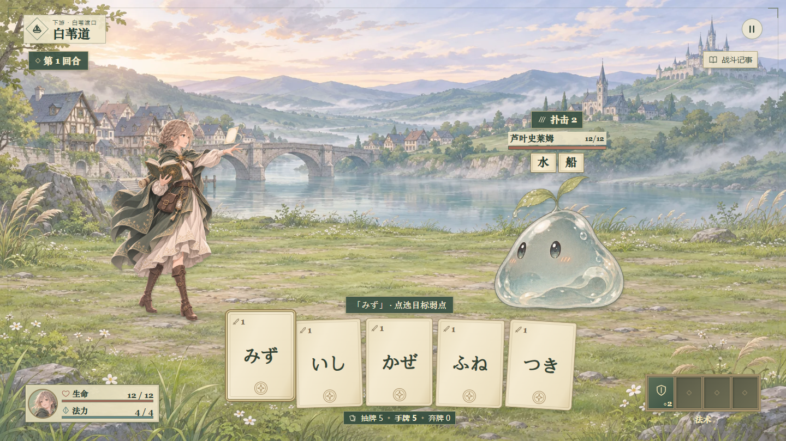
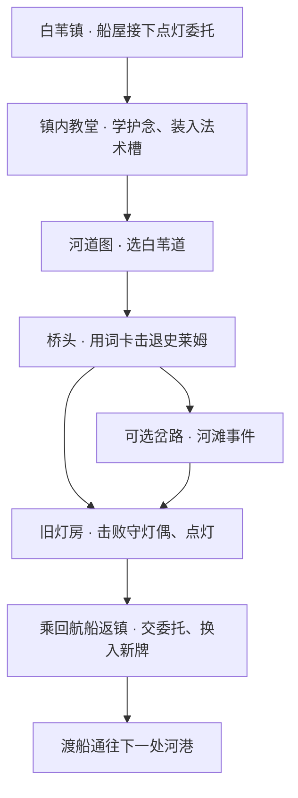
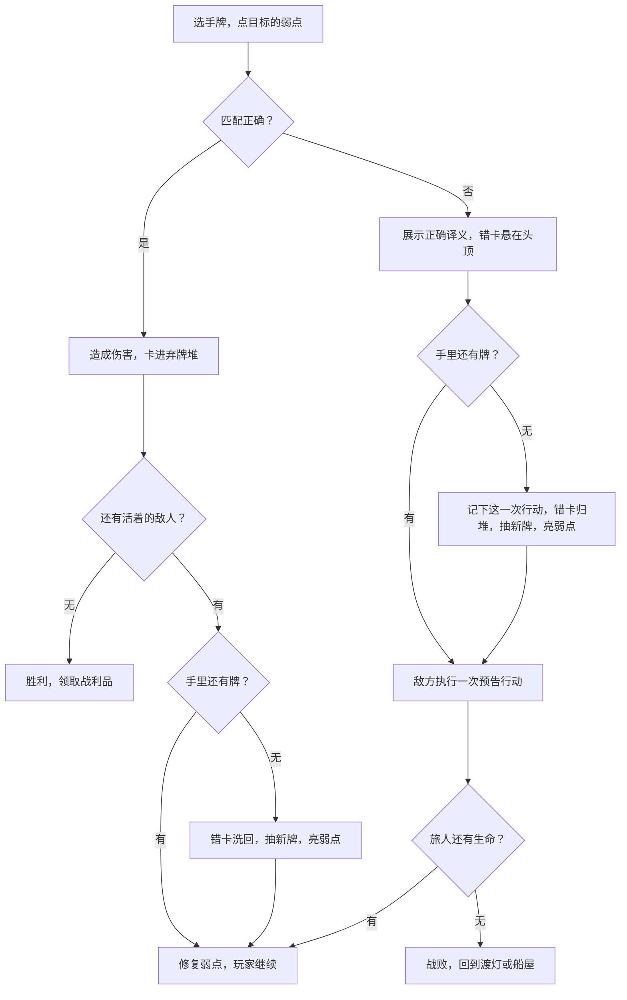

# 雾河的魔导书｜游戏策划案

> **v1.5 · 2026-11-18 · 三段航线可玩版**  
> 面向电脑浏览器的单人角色扮演游戏。玩家扮演见习魔导师，用日语词卡战斗，搭渡船沿河旅行。取得的牌、学过的法术和重新点亮的航灯都保存在同一份旅程里。  
> **美术与界面【已确认】** 日式西幻轻小说风格（人物用日漫线稿与柔和设色，世界采用欧洲中古河港、教堂、城堡和魔法学院）。低饱和非像素插画铺满场景，手牌、腰带护符和手札承担交互。

[打开本地游戏](index.html)　双击目录中的 `index.html` 即可开始。文字与插画都随游戏一起提供。

[首趟冒险](#first-trip) · [战斗规则](#combat) · [界面与美术](#art-and-ui) · [首章制作范围](#first-chapter)

---

## 0. 游戏核心理念

白苇渡口起了雾。船还系在岸边，对岸的灯却灭了。玩家受摆渡人所托，带一匣写着日语的符卡去修灯。桥头的史莱姆亮出「水」与「船」两枚弱点，手里的「みず」能击中前者，「ふね」能击中后者。能认出哪张牌，就能使出哪一击。点亮渡灯以后，从镇上能望见对岸的船动了。

玩家在持续存在的世界中探索、收集词卡、向不同法术导师学习技能。熟悉的牌能稳住一场战斗，新学会的词可以造成更高伤害、打开更远的航段。首章从一盏灯开始，长期目标是让整条雾河复航。



*白苇道第一场战斗的浏览器截图。旅人选中了「みず」，接下来可以点史莱姆头上的「水」。两枚弱点签同样明亮；上方「扑击 2」表示答错时会触发的动作和伤害。*

**战斗的关键规则：** 玩家攻击弱点成功则继续行动；玩家攻击弱点失败则触发**敌方一次行动**，之后玩家继续行动。整组手牌全部用完才结束一个回合；战斗持续至一方获胜。

**【已确认的新卡牌循环】** 成功使用的卡进入**弃牌堆**；失败卡本回合暂时悬浮在玩家头顶，供鼠标悬停复习正确翻译，**回合结束时才洗入抽牌堆**。普通回合结束**不重洗整副卡组**。

- **【已确认】** 角色长期成长，战败后沿用同一份存档继续旅程。
- **【已确认】** 地图固定骨架 + 局部随机，允许往返已有地点。
- **【已确认】** 采用 MVC 架构（把游戏规则、玩家操作和画面分开），词卡、技能、敌人均可通过数据扩充。
- **【已确认】** 首版学习语种为日语，无语音。**【首版方案】** 剧情、操作说明与词义采用简体中文，手牌保留日文。
- **【已确认】** 不设置玩家主动结束回合按钮。
- **【已确认】** **弱点**指敌人头顶能用手牌命中的目标。

### 策划标记

**【已确认】** 表示已选定的方向与规则。**【首版方案】** 表示本稿给出的可直接试做的内容、数值或取舍。表格中的数值、剧情地名及未另行标记的新增细节均按首版方案理解。**【试玩目标】** 表示需要用实际对局检验的体验指标。

---

## 1. 世界、地图和成长

### 1.1 四个主要界面【已确认】

| 界面 | 玩法 |
| --- | --- |
| **世界大地图** | 选择城镇、地区、道路、战斗、任务、特殊事件 |
| **区域小地图** | 俯视布局，进入酒馆、铁匠铺、公会、草药铺等建筑 |
| **第一人称室内场景** | 与 NPC（由游戏扮演的角色）交谈、购物、接受任务、向导师学习技能 |
| **卡牌战斗** | 根据日语词卡攻击敌人亮起的中文弱点，处理敌方行动、技能和胜负 |

<a id="first-trip"></a>

### 一趟冒险怎么走【首版方案】



| 玩家走到哪里 | 玩家亲手做的事 | 看得见的结果 |
| --- | --- | --- |
| 白苇镇船屋 | 点窗边的摆渡人。他说「以前在这儿，能看见对岸那盏灯。」接下委托，他交出干灯芯和起始牌匣 | 窗外的灯房仍暗着，镇图上标出教堂和出镇的桥 |
| 村庄教堂 | 向守灯修女艾琳请教，点祭台上的护符学习「护念」。腰带上有空位时会直接装备 | 盾纹出现在旅人腰带上，离开教堂就能使用 |
| 白苇道桥头 | 遇见芦叶史莱姆。首次只提示「选一张符卡，再点怪物头顶的弱点」。第一次真实失误时才教玩家悬停看译义 | 命中时怪物后缩。失误时符卡回旋至旅人头顶，怪物执行预告的动作 |
| 旧灯房 | 击败挡路的守灯偶，走进灯房，把灯芯放进空灯罩 | 远岸的船先亮一盏小灯回应，返镇捷径开放 |
| 再进船屋 | 向摆渡人交付委托，在桌上摊开牌匣，把途中取得的一张词卡换进卡组 | 同一扇窗外出现停靠的船，河道图可选下一航段 |

新旅程从白苇渡口的河道图开始，点白苇镇即可进镇。首趟主线预计 12～18 分钟。从桥头可直接去灯房，也可绕去河滩看看本趟的事件。出牌、错卡、施法与换装都在玩家第一次遇到时演示。

### 1.2 固定 + 随机地图【已确认】

- 城镇、主要道路、区域关系、关键 NPC 和技能学习地点长期固定，玩家可以识路、回访和规划路线。
- 野外遭遇、支线、临时商人、部分奖励与特殊区域可随机变化。
- 每个长期角色存档保存已探索地图、已完成任务与已领取的一次性奖励。返回场景、战败或读档不能刷新一次性内容。
- **【首版方案】** 手工绘制固定道路，只给少数地点预留随机事件。规则层决定并保存事件，再次打开地图时恢复原状。
- 城镇、导师和地区首领都有固定来路与返回路径。各航段只抽取本地区难度内的事件。

### 1.3 长期成长【已确认方向】

玩家等级逐步提高当前可用卡组容量，**最高 50 张**。长期卡牌收藏和已经学过的日语词汇可以超过 50 个；换掉一张牌不会忘掉学习档案。

长期保存角色等级、卡牌收藏、当前卡组、学会的技能、四个装备技能槽、地图探索、任务以及正确率与错题记录。战败后的落点与保留内容见 §1.5。

### 1.4 航线和地区推进【首版方案】

| 航段 | 玩家要完成的事 | 新开的玩法与可获得词卡 |
| --- | --- | --- |
| 下游 · 白苇渡口 | 重燃旧灯房，在船屋交付第一份委托 | 教堂学习保护法术。以河岸、天气和日常名词建立初始牌匣，地区奖励为难度 1～2 |
| 中游 · 苔桥集市 | 顺着货签找到搁浅的驳船，为第二处码头恢复灯号 | 法师小屋教换牌，林缘的女巫教舍牌。引入买卖、移动等动词与短语，地区奖励为难度 2～4 |
| 上游 · 雾钟港 | 穿过封航的水闸，重启港口主灯，乘首班船返回白苇镇 | 法术学院教扩充手牌。把不同地区词汇带进同一场长战，地区奖励为难度 3～5 |

三处灯都点亮后，河道图上连起整条航线。到引航人值房报信，乘首班船回到白苇镇，主线完结。原存档可自由回访导师、补地区词卡和再打普通遭遇。可玩版包含三个航段。

### 1.5 等级、整备与存档【首版方案】

| 项目 | 首版取值与结果 |
| --- | --- |
| 起步与升级 | 角色从 1 级、12 点 HP（生命值）、4 点 MP（法力值）开始，铜币与经验均为 0。1 级升 2 级需 8 点经验，之后每级比上一级多需 2 点，溢出经验保留。每次升级生命上限加 1 |
| 卡组容量 | 1 级可带 10 张，此后每级加 2 张，最高 50 张。6 级可带 20 张，21 级达到 50 张。在镇内或已点亮的渡灯处整理牌匣，至少保留 5 张可用词卡 |
| 生命与法力 | 战后保留当前生命。镇内船屋歇脚和已点亮的渡灯可免费补满生命。每次开战补满法力，回合间不回蓝。角色 6、11、16、21 级各加 1 点法力上限 |
| 战败 | 返回最近启用的渡灯，尚未点灯时回白苇镇船屋，生命恢复。本场没有胜利奖励。已得财物、技能、任务进度以及刚才出错的词全部保留 |
| 保存与续玩 | 同一浏览器使用一份本地自动存档。出入地点、领赏、换装、学习技能和每个完整战斗行动结算后保存。战中关闭后，继续游戏恢复到最近一次结算完成时的手牌、敌群和行动顺序 |

出镇时在河滩抽取一个事件并存档。漂来的货箱可开出 4 枚铜币，临时商人按船屋价格出售一张本地区词卡，击败纸灯灵可得普通战利品。每趟只能领取或买走这一份。看地图、在野外折返或刷新页面都沿用这次结果，返镇后再出镇会重新抽取。主线的灯芯、点灯和报酬另记，每个存档各一次。

---

## 2. 词卡与获取

### 2.1 词卡类型【已确认】

卡牌承载日语词汇、平假名或片假名，目标是识别其对应的中文含义或读音。日语词卡出现在玩家手牌，敌人头顶亮起可匹配的**中文弱点**。

假名练习使用音节或字形作为目标。下文的「正确译义」用于假名卡时，显示对应读音或配对字形。

### 2.2 难度影响伤害【已确认方向】

词汇越难、越复杂，**成功匹配造成的基础伤害越高**。难度应在词条数据中配置，不直接按字数推断。

| 难度 | 日语示例 | 首版基础伤害 |
| --- | --- | --- |
| Lv.1 | みず（水） | 1 |
| Lv.2 | でんしゃ（电车） | 2 |
| Lv.3 | しゃしんをとる（拍照） | 3 |
| Lv.4 | しゅうりする（修理） | 4 |
| Lv.5 | よやくをへんこうする（更改预约） | 5 |

等级与伤害数字均为**【首版方案】**。这里的等级衡量词条在本游戏中的难度。

### 2.3 五种不同的数据归属

| 名称 | 负责内容 |
| --- | --- |
| **全局卡牌库 CardLibrary** | 词条 ID、日文、含义、类别、难度、可获得阶段及权重 |
| **玩家收藏 Collection** | 已永久取得的词卡 |
| **装备卡组 Deck** | 当前用于战斗抽牌的卡牌实例，上限随等级提高，最高 50 |
| **战斗抽牌堆/手牌/弃牌堆/本回合错题暂存区** | 本场战斗内卡的当前位置：打对的卡进弃牌堆，打错的卡暂存在头顶，回合末再洗入抽牌堆 |
| **敌人弱点偏好库 WeaknessPool** | 当前敌人选择词类、难度等弱点的偏好，仅可从**当前实际手牌**找合法候选 |

卡牌由词条 ID 关联，不能单纯比较显示文字；多解、同义词和重复卡需要避免产生歧义。

### 2.4 奖励卡池【已确认方向】

先根据当前地区、剧情或冒险进度**筛选允许出现的词卡难度**，然后才在合法卡池内随机发放卡牌；前期不能意外抽到极高难度卡。

**【首版方案】** 初始地区允许难度 1～2，后续地区逐步开放难度 3～5。奖励来自战斗、商店、任务和事件。卡组满时，获得的卡进入收藏，等待玩家选择替换，已学记录继续保留。

### 2.5 第一匣牌与收获【首版方案】

进入船屋首次领取牌匣时，以下 10 张各有一份，全都装备，均为难度 1、基础伤害 1。首次教学战预排首手与「水」「船」两枚弱点。若玩家已改过牌匣，则照实际卡组发牌、亮签。

| 牌匣位置 | 日语与中文释义 |
| --- | --- |
| 首手五张 | みず（水）、いし（石头）、かぜ（风）、ふね（船）、つき（月亮） |
| 其余五张 | やま（山）、いえ（房子）、ほし（星星）、かさ（伞）、いぬ（狗） |

下游战利品和商店从另外六种词卡中选。难度 1 有「そら」（天空）、「くつ」（鞋），难度 2 有「わたる」（渡过）、「てらす」（照亮）、「はこぶ」（搬运）、「みちしるべ」（路标）。点灯委托的「あかり」单独领取。

- **战利品。** 普通遭遇胜利给 4 点经验、4 枚铜币，再从本地奖励池等机会选出 3 张不同词条，供玩家挑 1 张。合法候选少于 3 张时展示实际数量。整场按一次遭遇发奖，分裂出的个体共用这份奖励。
- **买牌和换牌。** 船屋柜台常备下游六种词卡，每张 8 枚铜币，可翻面查看释义再买。新卡先入收藏，牌匣满时可在整备地点用它换掉一张旧牌。取得同词的第二张会多一份实体，同一词条最多装备两份，多余份数留在收藏。
- **灯房结算。** 首胜守灯偶给 8 点经验、8 枚铜币和一次下游词卡三选一。回船屋交委托得固定新卡「あかり」（灯光，难度 2，基础伤害 2），并解锁中游航段。沿主路各胜一次，旅人升到 2 级、余 4 点经验。初始 10 张加上两张战利品和这张委托卡，共有 13 张，下一趟最多带 12 张。

### 2.6 词义判定与旅途手札【首版方案】

每张词卡分别记录书写、读音、练习的义项（本张卡表示哪一个意思）和可接受答案。「ふね」可以接受「船」「船只」，同屏只亮其中一种写法。遇到相同假名的不同义项，例如「はし」可指桥或筷子，卡面改印「橋（はし）」与「箸（はし）」，或给可区分的日语短句。两种意思没有足够线索时，只将已消歧的卡放入奖励池。假名练习用带「音」字的小签，如「か」对应「ka」，与词义签区分。

有可接受义项就算命中，玩家可用同词的任一实体卡。悬停手牌能放大日文与伤害值。译义在镇内牌匣、错卡悬浮提示或战后手札中可读。每次实际匹配给该词记一次命中或失误，舍牌、看提示和取消选牌不计。旅途手札（旅人随身的词卡记录）按遇见的地点留下一行日文、读音、中文和上次失误，合上就回到原场景。

---

<a id="combat"></a>

## 3. 战斗术语与执行顺序

### 3.1 三层单位【已确认】

| 层级 | 术语 | 定义 |
| --- | --- | --- |
| 最小 | **行动（Action）** | 一次玩家攻击弱点、施放技能，或一次敌人攻击、分裂等具体效果 |
| 中间 | **回合（Round）** | 一组手牌从抽出到**全部离开手牌**的过程，可包含多次玩家行动与敌方行动 |
| 最大 | **战斗（Battle）** | 从遭遇敌人直到一方胜利，包含多个回合 |

**敌方行动 ≠ 回合结束。** 玩家攻击失败后，敌人获得一次行动机会，但如果玩家手里还有卡，仍是**同一回合**，敌人行动完后玩家继续。

### 3.2 每个回合开始：先抽牌，再亮弱点【已确认】

1. 计算本回合抽牌数：基础 **5 张**，叠加有效的玩家技能或敌人技能；例如“下回合 +3”则抽 **8 张**。
2. 抽牌完成、最终手牌确定以后，才刷新敌人亮起的弱点。
3. 敌人头上只有有限数量的**弱点显示槽**（可同时亮起的词义签）。首版普通敌人 1～2 槽、强敌 2～3 槽，各敌人的首发配置见 §4.2。
4. 每个亮起的弱点都必须由**当前手里存在**的日语卡正确匹配；显示容量不是整回合的攻击次数上限。
5. 同时出现多个敌人时，全部亮起弱点的合法答案不能互相抢占唯一一张实体卡。

**【首版方案】** 首次分配时按敌人站位轮流亮一枚，再分第二枚。手中只有两张牌、场上有四只怪时，只给其中两只亮签。后续保留仍有独立答案的旧签，优先给没有签的敌人补缺。敌人的词类偏好排在可解性之后，只要还有手牌与活敌，就至少亮一枚能命中的签。点敌人身体或空地只改变查看目标。

每场遭遇开始时，以当时装备的所有实体卡组成抽牌堆并洗牌，手牌、弃牌堆和头顶暂存区均为空。首次桥头教学按 §2.5 安排首手。战斗结束后收回这一战的牌，收藏与装备关系保留到下一场。

### 3.3 玩家攻击弱点成功【已确认】

- 玩家左键选择一张日语卡，再左键点击**某个目标敌人**亮起的中文弱点。
- 匹配正确：对该目标造成基于词卡难度的伤害；卡牌离开手牌、进入弃牌堆。
- 先检查胜负。还有敌人和手牌时，立刻按剩余手牌修复缺位（最多到各敌人的显示上限）。
- **玩家继续行动。** 普通敌人不会因为玩家答对而得到免费行动。
- 若玩家当前手牌全部用完，**结束本回合**；若敌人全部被击败，直接结束战斗。

### 3.4 玩家攻击弱点失败【已确认】

1. 错配不造成命中伤害，立刻显示所用日语卡的**正确中文翻译**。**【首版方案】** 战后在手札的这次失误旁，也记下目标弱点的一种正确日语答案。
2. **失败卡离开手牌，进入本回合错题暂存区，并悬浮显示在玩家头顶**。玩家鼠标悬停这些卡时可复习其正确中文翻译；本回合期间不重新抽到该卡。
3. 这次失败让敌人按照自身行动队列获得**一次行动**，可能是攻击、分裂、强化、施法等。
4. **失败本身不再固定扣血，也不会直接强制结束回合。** 是否受伤取决于敌人实际执行的行动：敌人攻击可能扣血，敌人分裂则未必造成伤害。
5. 如果玩家仍有手牌，敌人行动结算后根据剩余手牌、敌人数量修复/补充弱点，**玩家继续行动**；回合尚未结束，错卡继续悬浮供复习。

**【已确认】错卡只在本回合结束时才离开头顶暂存区，被洗入卡组的抽牌堆；不能在一次失败后立刻回到抽牌堆，也不能错误地进入弃牌堆。** 初次匹配失败时仍应显示正确翻译的即时反馈，之后可通过头顶悬浮卡反复查看。

**敌人仅因为玩家攻击弱点失败而执行其普通行动。** 如果未来加入特殊被动触发，需要另行明确设计，不能悄悄改变这条基础规则。

### 3.5 最后一张手牌失败：特殊时序【已确认】

最后一张卡攻击弱点失败时，这张卡进入玩家头顶的错题暂存区，**玩家手牌归零**。此时：

1. 记录这次失败带来的**一次待执行敌方行动**，尚不立刻执行，避免与换回合顺序冲突。
2. 手牌耗尽，当前回合结束：将头顶全部失败卡**一次性洗入剩余抽牌堆**，清空本回合错题暂存区；**不洗混弃牌堆及整副装备卡组**。
3. **先抽下一回合手牌**，再根据新手牌**刷新敌人弱点**。
4. **敌方优先执行刚才记录的那一次行动**。
5. 如果该行动造成分裂、敌人死亡或其他弱点变化，再依据现存手牌修复弱点。
6. 若战斗未结束，**玩家获得行动权**，开始使用新手牌。

```text
末张失败 → 错卡悬浮并展示翻译 → 手牌归零 → 结束回合
        → 错卡洗回抽牌堆 → 抽新牌 → 刷新弱点 → 敌方行动（仅一次）
        → 必要的弱点修复 → 玩家行动
```

单次失败只生成一次敌方行动机会。**【首版方案】** 错卡先正面停留约 1.2 秒，再自动播放归堆与换牌；停留时间待试玩。译义还会留在战斗记事里，玩家可以回看。

这里有一个容易忽略的边界。按 §3.2，只剩一张手牌时，每个可点击的弱点都必定接受它，正常点选不会产生末张错配。仍保留上面的结算顺序，验证时从「末张的匹配结果已判为失败」开始检查，避免为了演示这条分支而给玩家亮出无解弱点。

### 3.6 完整流程示例【已确认】

以下从本回合还剩三张手牌时开始。

```text
玩家行动：攻击「水」弱点 → 成功 → 更新弱点
玩家继续行动：攻击「山」弱点 → 失败 → 显示正确翻译
敌方行动：攻击玩家 → 玩家按该技能受到伤害
玩家行动：攻击「猫」弱点 → 成功 → 更新弱点
玩家手牌耗尽 → 本回合结束
新回合：抽牌 → 更新弱点 → 玩家行动
```

如果失败的是最后一张牌，则按 §3.5 的特殊顺序：**先进入新回合并抽牌，再让敌人行动**。

### 3.7 回合与战斗结束条件【已确认】

- **回合结束：** 这一组手牌全部处理完（成功出牌、失败卡进入暂存区、合法技能舍牌等都可能使手牌数量减少为零）。回合末才把头顶错卡洗入抽牌堆，清空悬浮区。
- **敌方行动完成：** 若还有手牌，返回玩家继续行动，**不结束回合**。
- **战斗结束：** 玩家死亡或所有敌人死亡。
- **不存在玩家主动结束回合按钮。** 不认识弱点时，玩家需要真实尝试或使用消耗 MP 的合法技能，不能免费跳过。
- **【已确认】** 成功使用的卡进入弃牌堆；失败卡只在回合结束时洗入抽牌堆；**每回合结束不自动重洗整副卡组**。
- **【首版方案】** 回合末把错卡随机插入剩余抽牌堆，各位置机会相同，其余牌的相对顺序保留。抽牌时先取尽已有的牌；仍欠牌时才洗弃牌堆续抽。两堆都空则按实得张数开局。例：要抽 5 张、抽牌堆有 3 张，先取这 3 张，再从洗过的弃牌中补 2 张。

### 3.7.1 卡牌四区流转

| 当前动作 | 卡牌去向 | 是否立即洗牌 |
| --- | --- | --- |
| **回合开始抽牌** | 抽牌堆 → 当前手牌 | 抽空且仍欠牌时，用弃牌堆补充 |
| **攻击弱点成功** | 当前手牌 → 弃牌堆 | 否 |
| **攻击弱点失败** | 当前手牌 → 玩家头顶错题暂存区 | 否；悬浮可供鼠标复习 |
| **手牌用尽、回合结束** | 头顶错题暂存区 → 抽牌堆（洗入） | **只洗入这些错卡，不重洗整副卡组** |
| **下一回合抽牌** | 从抽牌堆抽取，随后刷新弱点 | 仅抽空且仍欠牌时才洗回弃牌堆 |

四区分别保存**同一个实体卡实例的唯一位置**：抽牌堆、手牌、弃牌堆、错题暂存区；悬浮展示只是错题暂存区的视图，不是第五张复制出来的卡。

### 3.8 同级战斗时长与练习量【试玩目标】

希望实力相当的普通战斗**约 2～3 个回合**击败敌人，并将**累计约 20 张成功匹配**作为学习练习目标量级，不是强制“答满 20 才能获胜”的门槛。

| 场合 | 能出几张牌 | 用什么判断体验 |
| --- | --- | --- |
| 白苇道普通战 | 基础每回合 5 张，2～3 回合合计最多 10～15 次成功。用全套初始卡打 12 生命的史莱姆，全对时第 3 回合第 2 张结束 | 首版优先看同级普通敌人是否能在约 2～3 回合击败，同时记录实际成功数；不为了凑 20 次延长这场战斗 |
| 学院扩手试炼 | 第一回合施放「丰页」，随后两回合各多抽 3 张，三回合共有 5＋8＋8＝21 次出牌机会 | 对照局给试炼灯偶 40 点生命、无减伤。全带难度 2 的牌，每次命中打 2 点，连续命中时第 3 回合第 7 张取胜，刚好成功 20 次。换高伤害卡可以提前取胜 |

试玩分别记回合数、成功匹配数、基础及实际伤害、额外抽牌来源。对照相同卡组打同级普通敌人与扩手试炼，两组的时长和练习量分别报告。

可玩版用同一副 12 张难度 2 的卡做了规则对照。连续全对时，白苇道史莱姆在第 2 回合第 1 张倒下，共 6 次命中、12 点实际伤害。学院试炼首轮施放丰页后，后两轮各多抽 3 张，灯偶在第 3 回合第 7 张倒下，共 20 次命中、40 点实际伤害。首趟旅行的 12～18 分钟仍为真人试玩目标。

---

## 4. 敌人行动队列与多敌人机制

### 4.1 每次失败推进一次敌人行动【已确认】

敌人有各自的战斗特色：可以配置行动队列、生命值、攻击伤害、弱点显示容量、弱点偏好和技能。敌方行动并不是“固定扣 1 HP”，而是某个具体动作。

**史莱姆示例：攻击 → 分裂 → 攻击 → 分裂 → ……**

**【首版方案】** 选错哪只敌人的弱点，就推进它所属的行动队列一次。普通敌人各用自己的队列，同群芦叶史莱姆共用一条。轮到扑击时，只有被点中的史莱姆打一下。轮到分裂时，用行动开始时的同群成员各尝试分一次，新生个体从下一次行动起参与。

| 累计攻击失败次数 | 本次敌方行动 | 史莱姆数量 |
| --- | --- | --- |
| 0 | 尚无 | 1 |
| 1 | 攻击 | 1 |
| 2 | 分裂 | 2 |
| 3 | 攻击 | 2 |
| 4 | 分裂 | 4 |

独立遭遇从一只 12 生命的史莱姆开始。分裂平分该个体的当前生命，奇数时本体多留 1 点；各自以分到的值作为当前生命和新上限。例如 7 分为 4 和 3。原个体保留自身状态，新个体无单体状态，二者继续共用队列。1 点生命无法再分，全场最多同时 4 只。空位不足时从被选目标起按站位分配。没有可分个体时，这次行动只播放颤动，队列照常前进。这样，连续四次失误且无怪物死亡和受伤时，史莱姆会从 1 只变为 2 只，再变为 4 只，总生命仍是 12。

### 4.2 首章敌人与后续机制【首版方案】

| 下游敌人 | 生命 / 弱点槽 | 只在失误后推进的行动队列 | 玩家能提前做的判断 |
| --- | --- | --- | --- |
| 白苇道 · 芦叶史莱姆 | 12 / 2 | 扑击（2 伤害）→ 群体分裂，循环 | 爪痕表示下一次会挨打；双叶影表示下一次会多出目标，此时可集中清掉低生命个体 |
| 河滩试炼 · 纸灯灵 | 9 / 1 | 借光（玩家下一回合多抽 3 张）→ 擦碰（2 伤害），循环 | 灯罩亮起三道刻线时，触发失误会给后续手牌加量。行动实际执行在哪一回合，额外抽牌就加在它的下一回合 |
| 旧灯房 · 守灯偶（首章首领） | 16 / 2 | 举灯蓄势 → 横扫，循环。横扫基础 2 伤害，有蓄势再加 2，命中后消耗蓄势 | 举灯伤害为零。下次行动的灯臂会拉开，预告写「横扫 4」，此时「护念」可以抵去其中 2 点 |

下游三种敌人都承受词卡的完整基础伤害。反复触发借光时，只为同一个下回合保留一次加 3。中上游可以在已有动作上组合以下机制。

| 敌人方向 | 候选效果 |
| --- | --- |
| **援助/试炼型** | 让玩家**下一回合额外抽取 3 张手牌**，提升连击与学习机会 |
| **装甲守卫** | 带甲时每次受击减去 1 点，命中至少造成 1 点。高难卡仍能打出较高伤害 |
| **词类专家** | 偏好某些类型的弱点，可有针对词类的抗性/弱点 |
| **连击守卫** | 玩家连续答对指定次数后，才能解除护盾 |
| **变幻敌人** | 通过行动技能改变其弱点显示槽容量或展示方式 |
| **召唤者** | 被触发时召唤新敌人，扩大可攻击目标，但不创造无解弱点 |

行动预告随队列推进。显示分裂时若已达上限，预告改为「颤动」。同群行动用同一枚双叶纹标注，共用队列的怪物只收一次行动机会。护盾或抗性须预留任何卡组都能推进的伤害途径。

### 4.3 多敌人弱点限制

分裂后，多只敌人可同时亮起弱点，但**所有亮起的弱点都必须能由当前玩家实际手牌合法匹配**。同一张唯一可用的卡不得被重复强制分配给多个互斥的弱点槽。

玩家点击的是**具体敌人的具体弱点**；击杀目标后清理该敌人的弱点与行动状态，再由 Model 根据仍存活敌人与当前手牌更新弱点。

---

## 5. 玩家法术、蓝量与导师

### 5.1 技能装备与 MP【已确认】

- 玩家可在世界中学习多个技能，但**同时装备最多 4 个技能**。
- 所有**主动技能施放消耗蓝量 MP**，不占日语卡组的 50 张容量。
- 前期玩家在**整场战斗内**通常只有约 **1～2 次普通技能释放预算**。
- **【首版方案】** 初期每战 4 MP，普通法术消耗 2～3 MP，预留 4 MP 给后续强力法术。每场开战补满，回合间不自然回蓝。等级与法力上限见 §1.5。
- 施放时先检查技能已学且已装备、MP 足够、目标合法、时机允许；**只有技能成功执行才扣 MP**。失败或取消不扣蓝。
- 换牌/额外抽牌法术必须**先改变手牌，再根据最终手牌更新弱点**；不能把旧弱点留给已经不存在的卡牌。

### 5.2 技能学习地点【已确认】

| 地点 | 风格（建议） | 偏好的技能机制 |
| --- | --- | --- |
| **法师小屋** | 奥术、控牌 | 换牌、抽牌、刷新弱点 |
| **女巫小屋** | 巫术、契约 | 舍弃手牌换高伤害、承担风险获得加成 |
| **村庄教堂** | 祝福、保护 | 减轻敌人攻击伤害、教学提示、保护生命 |
| **法术学院** | 研习、综合 | 预知、词类连携、进阶技能 |

地点应有固定可找到的入口；随机出现的特殊导师或课程可以作为补充。学会技能与装备技能是不同动作，学习进度长期保留。

### 5.3 能学到什么法术【首版方案】

| 技能与导师 | 费用 | 点击后发生的事 |
| --- | --- | --- |
| 护念 · 下游教堂，初访赠予 | 2 MP | 在旅人身前亮起盾纹，下一次受到攻击时减去 2 点伤害，最低降至 0。分裂或蓄势会照常发生并保留盾纹，直到挡过一次攻击 |
| 看破 · 下游教堂，交回点灯委托后传授 | 2 MP | 点一枚弱点签，签角写出一个可接受答案的首个假名，留到该签离场。玩家仍须自行选择手牌并决定何时出牌 |
| 重整手牌 · 中游法师小屋 | 2 MP | 选一张手牌，有其他牌可抽才施放。先从牌堆抽 1 张，再把选中的旧牌送入弃牌堆，按最终手牌修复弱点。此次换牌不计错题 |
| 舍牌爆发 · 中游女巫小屋 | 3 MP | 选一张手牌放入弃牌堆，下次正确命中的基础伤害翻倍。舍掉末张会自动换回合，加成带到新回合，敌人不因此行动 |
| 丰页 · 上游法术学院 | 2 MP | 接下来两个回合开局各多抽 3 张，牌匣撑开两枚铜扣，每生效一次合上一枚。当前回合手牌保持原状 |
| 预习 · 复航后回访符文师诺亚 | 2 MP | 依顺序看到抽牌堆顶部最多两张牌，下次抽牌后预告收起 |
| 连珠之力 · 复航后回访女巫薇拉 | 2 MP | 持续命中时，第二张加 1 点伤害，从第三张起加 2 点。一次失误会解除法术 |
| 洞悉 · 复航后回访导师希尔维 | 2 MP | 选中敌人现有的一枚签，展开一枚手里有牌可答的新弱点。同一敌人每战可扩展一次 |

见过导师并推进到对应地区即可学习，已学法术在整备地点拖入或点选放入四个装备槽。护念和舍牌爆发的效果可以跨回合，各自尚未消耗时不能重施；同一枚签上已有线索时不能重复看破。丰页有效期间不能重施，可与灯灵的一次借光相加。战斗结束时清空这些临时效果。

三处导师的进阶课程在乘首班船返抵白苇镇后开放。旅人可在整备地点点选已学法术，再点腰带位置替换上场法术。

---

<a id="art-and-ui"></a>

## 6. 游戏界面与美术

白苇渡口的第一眼是河面、旅人和那盏没亮的灯。玩家靠近哪里、点了什么，相关文字才在哪里出现。收下词卡是摆渡人递来一只匣子，回看错词是旅人翻自己的手札，换法术是把护符挂回腰带。全屏画面留给正在发生的事。

### 6.1 基础鼠标规范【已确认】

| 输入 | 操作 |
| --- | --- |
| **左键点击** | 选择对象或确认；战斗中左键选卡，再点击敌人的弱点 |
| **中键按住拖动** | 平移支持移动的地图/视野 |
| **鼠标滚轮** | 缩放世界与区域地图等支持缩放的视图 |
| **右键点击** | 打开场景/对象的上下文菜单 |

只在游戏画布内拦截必要的浏览器默认行为，避免影响页面其他区域。

战斗中右键可选「取消选牌」「查看意图」或「查看法术」。Esc 先合上最上层浮窗，再打开暂停菜单。鼠标暂时移出游戏时保留已有选牌。暂停菜单包含继续、声音、文字大小和返回标题。标题画面中船灯旁放「继续旅程」与「新的旅程」。

### 6.2 一屏战斗怎么读、怎么点

以开篇的白苇道概念图为构图参考。旅人立在左前景，怪物占右半场，两者之间留出让符卡飞过的空间。操作顺序由下往上：先看手牌，再看想打的敌人。

| 屏幕位置 | 常驻信息 | 操作与反馈 |
| --- | --- | --- |
| 左下 · 旅人头像 | HP、MP 的数值与细条，身旁留一个回合记号 | 扣血时头像旁跳出实际伤害，护念挡下时显示盾纹及抵消量 |
| 下沿中央 · 手牌 | 5 张牌浅扇展开，牌面日文最大，角上标伤害。牌匣两端标抽牌堆和弃牌堆张数 | 悬停把整张牌提到前面，左键使牌抬起、边缘出现双线。所有可点弱点保持同样亮度，玩家判断对应关系 |
| 敌人头顶 · 目标牌 | 从上至下排下一行动的图标与名称、该个体的生命条、可点的中文弱点签 | 点中签后才结算。命中时墨迹从签飞向目标，敌人后缩，生命条减去实际伤害；连续命中在签边短暂浮出次数 |
| 旅人头顶 · 本回合错卡 | 错卡短暂翻面，露出原日语和正确中文，再悬在头顶 | 悬停可反复读。超过 3 张时叠放并标张数，移入展开，逐张可读。回合末整叠回到抽牌堆，短译在战斗记事里仍可查 |
| 右下 · 四个法术槽 | 腰带上固定四个铜框，已装备槽显示纹样与费用，空槽保留凹痕 | 指向显示法术效果。需要对象的法术选好对象才生效，取消不扣 MP。法力不足时槽内敛光，显示「需 2，现有 1」等实际差额 |

例：选「いし」点「水」，纸签先轻颤，旅人头顶翻出「いし · 石头」。若预告为「扑击」，史莱姆扑上来并结算伤害，玩家随后还能打这一手剩余的牌。若预告为「分裂」，场上出现新个体和各自的生命条。反馈在角色之间发生，无需离开战斗阅读结果。手牌全部用尽时自动翻到下一回合。

### 6.3 四种镜头与场景内菜单【首版方案】

| 所在场景 | 主画面与入口 | 操作后的去向 |
| --- | --- | --- |
| 世界大地图 · 展开河道图 | 沿着手绘河岸找城镇、石桥、渡灯与船。可走的航线用连续墨线，未通航的渡口画系紧的缆绳。指向路标时就地浮出地名与已知风险 | 点目的地启程，沿线显示旅人棋子的移动。抵达后进入城镇俯视图或道路遭遇 |
| 区域小地图 · 俯看白苇镇 | 河岸、街巷和屋顶占满画面。船屋门楣挂桨，教堂立着小钟。从河道图进镇时，棋子落在码头 | 点门或招牌，角色走到门前再切室内。离开室内回到同一扇门前 |
| 第一人称室内 · 船屋与教堂 | 人物半身、柜台与屋内光源在同一幅画里。对话框贴下沿，框上压角色名签。初入船屋看向窗边，点摆渡人交谈，点桌边牌匣看货 | 从对话「让我看看」摊开柜台，从祭台取下护符学习法术。收起物件仍面对同一人，点门离开 |
| 战斗 · 白苇道 | 路边景物延续到战场，左侧露出旅人的肩和手，右侧进入敌人。只在这里展开整手符卡和行动预告 | 胜利后镜头落到路边的战利品，点一张收入牌匣，回到发生遭遇的路标。战败则在船屋或最近的渡灯边醒来 |

**牌匣、手札与结算。** 镇内点背包搭扣，左页是收藏，右页是这趟带的牌。两边都写明张数，选两张即可替换。脱战翻手札可以查看历次日文、译义与匹配记录，战斗记事只显示本场已经结算的动作。胜利呈现这次实际获得的铜币、词卡或委托进展；战败保留最后遇到的难词，写明将在哪座渡灯或船屋醒来。主画面不放课程导航、打卡日历、成绩看板或整屏的答题选项。

### 6.4 日式西幻轻小说的美术方向【实机采用】

封面上，麻灰色编发的见习魔导师抱着星盘封面的书，在石桥边回望。白苇镇的船屋用白灰泥和外露木梁建造，抵达雾钟港后，屋顶让位给水闸、学院尖塔和航灯。船屋的星盘、修女的银徽与旅人的斗篷扣重复使用同一枚八角星，让人物、信仰和航行器具属于同一个世界。游戏内插画及制作提示见[西幻美术制作说明](美术参考/西幻美术制作说明.md)。

| 美术要素 | 画法与用途 |
| --- | --- |
| 材质与轮廓 | 二维水粉薄涂，能看见连续笔触。苇草用三两笔概括，斗篷下摆和史莱姆外缘画出完整剪影。纸纹落在牌角和旧地图边缘，正文字面留净。素材按显示尺寸平滑缩放，禁用像素块、像素字与阶梯状描边 |
| 底色与用色 | 雾青灰 `#879B99` 用于远水，干苇绿 `#89917B` 用于河岸，暖纸白 `#EFE6D6` 承托词卡，松墨 `#303934` 写字，旧铜 `#A88C67` 点出选中边，灰朱 `#A45F59` 标伤势。法力用雾蓝与菱纹，生命用灰朱与心纹 |
| 光线与景深 | 漫射天光让远桥和山影淡下去，旅人、史莱姆和可点纸签拥有更清楚的明暗边界。未点灯时暖色只落在旅人附近；点灯后，同一个船屋窗口多一处暖色倒影，让任务进度能被看见 |
| 人物、怪物与道具 | 女主的苔绿斗篷、魔导书和星扣贯穿封面、战斗与头像。卢卡斯拿着缆绳，艾琳手托护符，符文师与女巫各有自己的立绘。史莱姆靠叶冠辨认，纸灯灵采用西式铜提灯骨架，守灯偶用石甲与灯芯构形 |
| 字与图标 | 地名与角色名可用有书写感的宋体，手牌与操作字使用清晰的日中字体，保留「ず／す」「シ／ツ」的细部。选牌同时抬高并显双边，失误同时翻面并回到头顶。去掉颜色也能辨认两种状态 |
| 动静与声音 | 灯芯微明微暗，人物呼吸时斗篷轻动。选牌有一声短促的翻纸声，施法是轻钟，史莱姆分裂时响起两声下滑的水泡音。系统选择减少动态效果时收起呼吸与飞牌动画，静音时也有动作名称与译义 |

### 6.5 排版验收【试玩目标】

- 以 16∶9 桌面画面构图，在 1280×720 检查最小布局。卡面日文至少 24 像素，弱点文字至少 20 像素，说明和数值至少 16 像素。长词可排两行，放大后完整显示。
- 五张牌直接排开，八张收拢为浅扇。更多手牌保留下沿横向滚动和两端翻牌箭头，指向牌时浮到最前。滚动手牌时只移动手牌，抽弃牌计数、法术槽固定。
- 同场四怪时错开前后站位，把生命条、意图和弱点作为一组随各自的怪物移动。用纸签引线区分归属。八张手牌、四只怪和三张以上的头顶错卡同时出现时，每个可选对象仍可逐一指到。
- 让首次看到画面的人指出自己的手牌、哪只怪要做什么，以及能点哪里攻击。用灰度画面和静音各走一遍选牌、失误、分裂与进店，检查动作和文字是否足以传达结果。

---

## 7. MVC 架构与数据模型

MVC（把规则、显示和玩家操作分开管理）用于保持卡牌、敌人和技能可按数据扩充。动画播放的是已经结算的结果。

| 层 | 职责 |
| --- | --- |
| **Model（规则与状态）** | 词卡与卡组、伤害、弱点判定、双方状态、行动队列、技能与 MP、长期存档 |
| **Controller（操作调度）** | 收到点击与技能选择后提交一次操作，按规则推进回合，并安排反馈的播放顺序 |
| **View（画面）** | 显示弱点、手牌、敌群分裂、生命与法力、世界地图和场景人物 |

### 7.1 建议的核心组件

- `CardLibrary`：词条 ID、日语、中文、难度、主题、获取条件、掉落权重。
- `DeckModel`：收藏、装备卡组、战斗抽牌堆/手牌/弃牌堆/**本回合错题暂存区**，每个实体卡有唯一实例 ID；只在回合结束时将错卡洗入抽牌堆，不在每次回合结束时重洗所有卡。
- `WeaknessSystem`：从**当前剩余手牌**生成/修复各敌人的合法弱点，处理多敌人显示槽容量与答案映射。
- `BattleModel`：HP、MP、当前回合、当前行动控制权、敌人集合、胜负和抽牌修正。
- `EnemyDefinition/EnemyInstance`：行动模式、当前行动索引、分裂状态、弱点显示上限、技能和 HP。
- `EnemyActionResolver`：每次失败产生**一次**敌方行动，处理中途失败、末张失败时排队、分裂、死亡和目标合法性。
- `SkillSystem`：已学技能、最多四个装备槽、MP 消耗、技能效果与持续时间。
- `LearningProfile`：词条正确率、错题、掌握程度和复习记录，持久保存。头顶错卡的悬浮属于本回合战斗临时数据，不应和长期错题记录混为一谈。
- `WorldModel/SaveModel`：长期地理、任务、等级、角色与知识档案存档。

### 7.2 一张牌如何推动战斗



技能或分裂导致可见弱点需要变化时，必须以**最终当前手牌与最终存活敌人集合**为准。行动结算需要避免双重触发、错误扣蓝、重复生成卡牌及已经死亡的敌人继续执行行动。

### 7.3 关闭后从哪里接着玩【首版方案】

一次操作产生的生命变化、四区内卡牌的位置、技能状态、敌方行动进度和本次词条记录一起保存。战斗存档还包含牌序、当前亮签及后续随机结果所需的状态。读档直接显示这个已完成的局面。末张失误、换轮和所欠的一次敌方行动合起来构成一个完整结算点。

胜利进入选牌时保存已生成的候选和「待领取」状态，此时退出，下次回来仍能挑原来那三张。玩家选好后将卡、铜币、经验和领取标记一起保存，再次进入时回到路标。城镇委托同样把报酬、任务进度和航线解锁一起保存。

---

<a id="first-chapter"></a>

## 8. 首个可玩章节的制作范围

验收从新建旅人开始，到回到白苇镇交付灯芯委托、换入一张新卡，再关闭并继续同一个存档结束。

| 交付内容 | 下游章节至少具备 |
| --- | --- |
| 一趟完整路线 | 一张河道图，一张可往返的俯视镇图，两间可交谈的室内（船屋、教堂），一处主线路战，一处河滩事件位和可点灯的旧灯房。船屋窗外、河道图和渡口捷径一起表现通航变化 |
| 一套可读的画面 | 旅人背影与小头像，两名场景人物，三种轮廓不同的敌人，手牌、弱点签、行动预告、四个法术槽、战利品和手札。旧灯房和船屋窗外各有亮灯前后两种状态 |
| 可带走的成长 | 初始 10 张、下游普通池 6 种、点灯委托固定 1 种。商店买牌、胜利选牌、收藏与换装、升级扩容。教堂能学护念和看破两种法术，并能装备和消耗法力施放 |
| 能反复挑战的战斗 | 四区流转，基础抽 5，正确匹配、错卡与敌方行动，史莱姆分裂，灯灵下回合多抽 3 张，守灯偶蓄势。可查看行动预告，所有亮签都可由当时手牌作答 |
| 可继续的存档 | 中途退出后可继续战斗或选牌，战败能重试，开通的渡口、已学法术、领取的奖励和实际错过的词均能恢复 |

首章交付点灯委托后，中游航线解锁。可玩版还包含苔桥集市的驳船、雾钟港的水闸和学院试炼。全程收录 62 种词卡、8 种法术和 10 种敌人（含试炼灯偶）。新开一份旅程同样从下游开始。

### 8.1 必须验证的边界情况

1. 玩家连续答对时，敌人不会自行获得行动；正确出牌后弱点依当前剩余手牌补充。
2. 中途失败但还有卡：失败卡只进入头顶错题暂存区，敌人只行动一次，随后玩家在**同一回合**继续，不抽新牌；悬浮卡鼠标悬停能看到正确翻译。
3. 从 §3.5 的末张失败结算状态验证：先在头顶给出可阅读的翻译反馈，再把所有错卡洗回抽牌堆。抽新牌并刷新弱点之后才有一次敌方行动。另测正常手里只剩一张时，每个可点的签都接受它。
4. 四次失败的史莱姆测试：攻击/分裂/攻击/分裂，若没有任何怪物死亡，分裂数量从 1 到 2 再到 4。
5. 分裂后的多个敌人不能共同强制要求唯一同一张卡做不可兼容的多处回答。
6. 当敌人的行动是分裂时，**不额外固定扣血**；只有真实攻击或已规定伤害效果才扣玩家 HP。
7. 敌人攻击导致玩家死亡时直接结束战斗，不恢复玩家控制权。
8. 手牌打完才换回合；敌人行动或弱点可见窗口清空不会自动结束回合。
9. 任何时候都不存在玩家主动结束回合按钮或免费跳题入口。
10. 影响抽牌的技能与敌方行动先完成手牌变更，再生成合法弱点；MP 只在合法释放时扣除。
11. 用相同卡组分别记录普通战和扩手试炼的回合数、成功数、额外抽牌与实际伤害，按 §3.8 的两组目标评估。
12. 战斗失败不清空长期角色、已获得卡牌、技能、地图探索和学习记录。
13. 每回合存在多个错卡时：头顶逐张显示/叠放且均可悬停复习，回合结束时**全部且仅一次**转回抽牌堆，不会重复生成或丢失实体卡。
14. 正确出牌三张、失败两张：正确三张只进入弃牌堆；失败两张先在头顶暂存，回合结束后只洗入这两张，既不洗混弃牌堆也不把整副装备卡组重新打乱。
15. 下一回合抽牌堆不足：仅此时才按弃牌堆补牌规则洗回弃牌；若仍足够，则不得因回合更替主动重洗弃牌堆。
16. 在领战利品前、领后、交付委托后分别关闭再继续。候选卡、经验、铜币和开通的航线与关闭前一致。一次性物品在原地点不会再次生成。
17. 分裂前的一击若使史莱姆剩 7 点生命，分裂后为 4 和 3。另一组敌人不推进队列。检查两者的生命条、签和目标点选能一一对应。
18. 使用同义答案、相同假名的不同词、同词的第二张牌和假名读音签各打一遍。每次判定与卡面线索相符，行动只给实际打出的词记一次学习结果。

---

## 9. 首轮试玩看什么

| 看哪一段 | 观察什么 | 哪种现象值得改 |
| --- | --- | --- |
| 进镇接委托 | 让第一次玩的人从河道图出发，自行找到摆渡人和教堂 | 如果玩家在找「任务列表」才知道去哪儿，先改门楣、道路或摆渡人的指向 |
| 打第一手牌 | 观察玩家第一眼看哪、会点哪。第一轮失误后，能否找到刚才的日语和正确意思 | 若把预告当弱点、把错卡当作还能出的牌，调整两者的形状、位置和动作 |
| 从五张变八张、从一怪变四怪 | 看哪张牌或哪只怪第一次被挡住，记下当时窗口大小和目标位置 | 优先调整扇面间距、怪物站位、纸签引线与展开方向 |
| 打完普通战和长战 | 记每战回合数、用过的词、成功数、法术次数、实际受伤和耗时；区分初识与熟悉这些词的玩家 | 普通战拖长先调敌人生命与牌组难度。扩手后若很难读清词义，先调整呈现与出牌节奏 |
| 回城后再出发 | 让玩家自己拿报酬、换一张新牌、指出地图上发生的变化，退出并继续同一趟旅程 | 若看不出点灯的意义，检查船、窗外灯光和新航线。若新牌不知去向，检查收牌到打开牌匣的反馈 |

---

<details>
<summary>附录 · 早期白苇渡口战斗构图</summary>

初稿用于确定手牌、预告与弱点的相对位置。此处留存[早期构图](美术参考/白苇渡口-战斗概念图.png)与当时的提示词；当前游戏画面见开篇实机截图。

**初稿**

横向 16:9，画一帧可游玩的日式幻想卡牌 RPG 战斗概念图。黄昏的白苇渡口，薄雾里有低矮石桥和一盏渡灯。左侧披灰绿斗篷的年轻旅人侧背对镜头，右侧一只顶着芦叶的青灰史莱姆。低饱和水粉手绘，大块柔和的冷暖明暗、细纸纹、连续笔触，角色轮廓清楚。四周只放游戏操作物，中部留给对峙。怪物头顶紧贴细血条、爪痕图标和「攻击」，下方仅两枚有连线的弱点签「水」「船」。底部中央五张纸白实体符卡浅扇展开，从左到右准确写「みず」「いし」「かぜ」「ふね」「つき」；第一张稍微抬高，卡面用抽象墨纹。左下角小头像配 HP 12/12、MP 4/4，右下角旧铜框四格法术槽，第一格盾纹，其余空。手牌清晰易读，弱点一视同仁。只出现指定的界面文字。无像素格、霓虹、网站导航、侧栏、答题框、说明标题、水印或设备外框。整张画就是游戏画面。

**卡面与弱点位置校正**

保留这幅白苇渡口的水粉原画、角色、色调、五张牌及其日语、四格法术栏、生命与法力数字。只校正战斗界面。五张卡的下半部改成同一种小小的旧铜圆印，印内都是一圈相同的几何点；擦除原来的山水船月等插画，以免图案泄露词义。把「水」「船」两枚弱点签从怪物脚下移到头顶叶尖与血条之间，紧挨对应怪物、文字清楚，两枚相同亮度。上方行动预告用爪痕和简体中文「扑击」（第二字写作“击”）；若字形无法写准，只保留爪痕。手牌里的五个日语原样保留。

</details>
